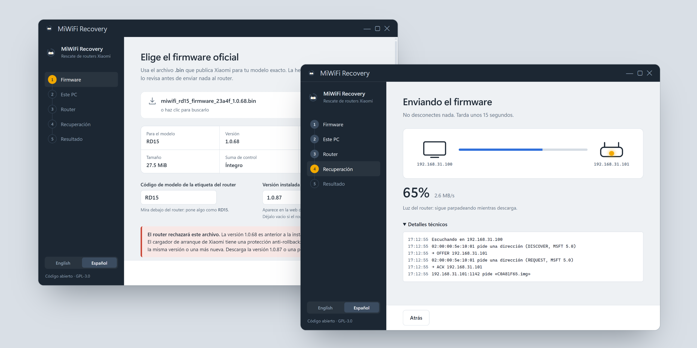
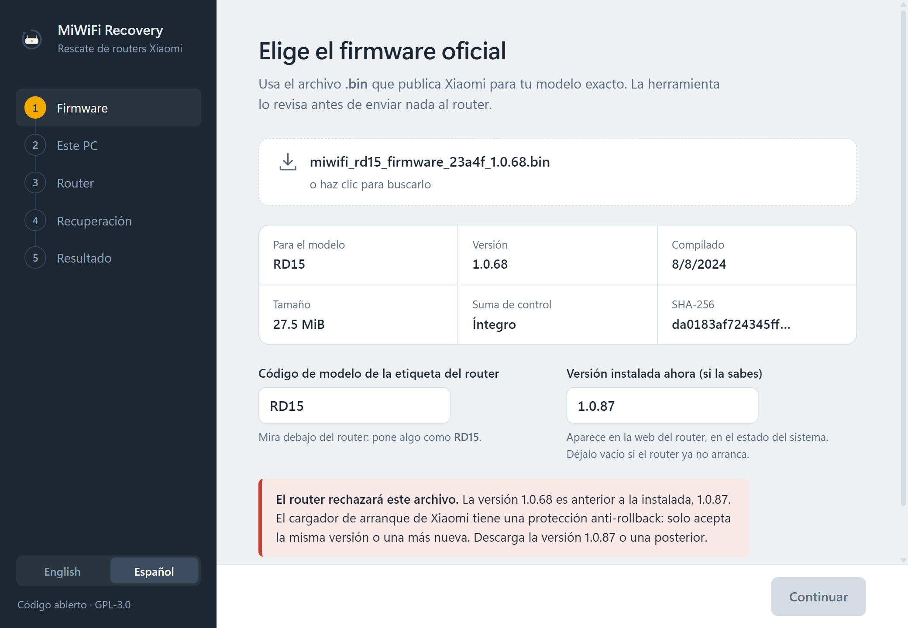
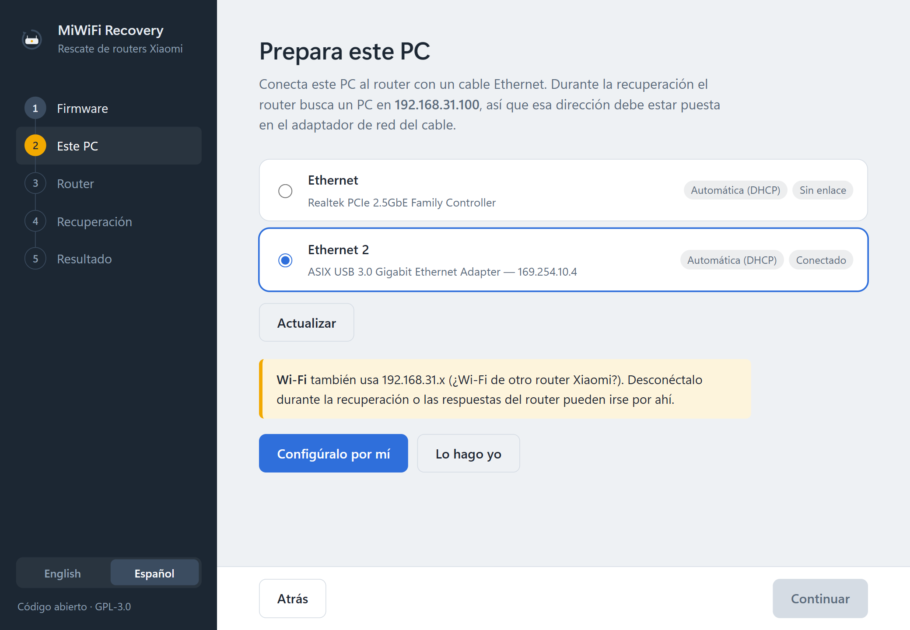
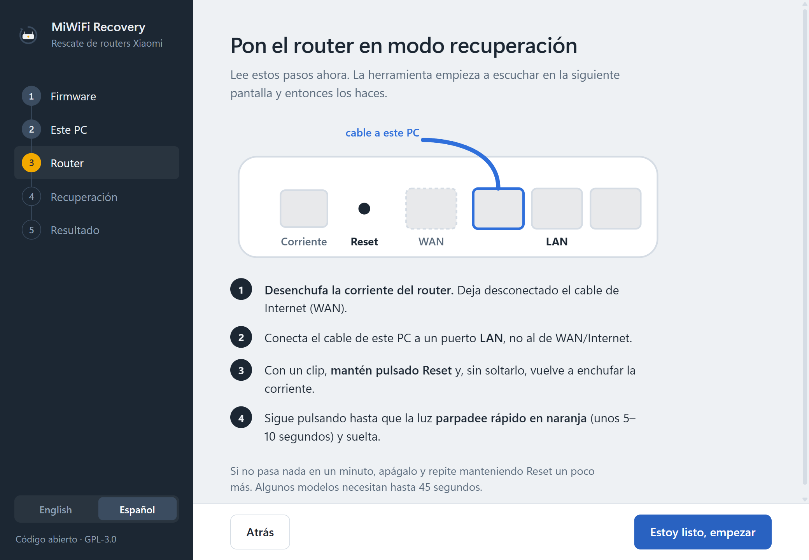
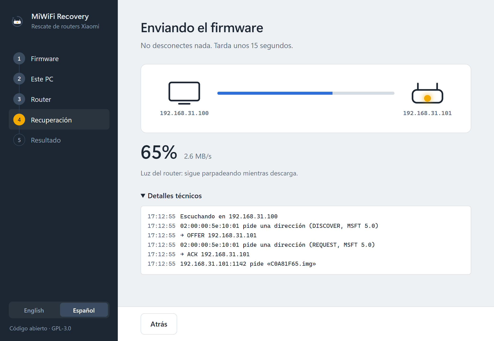
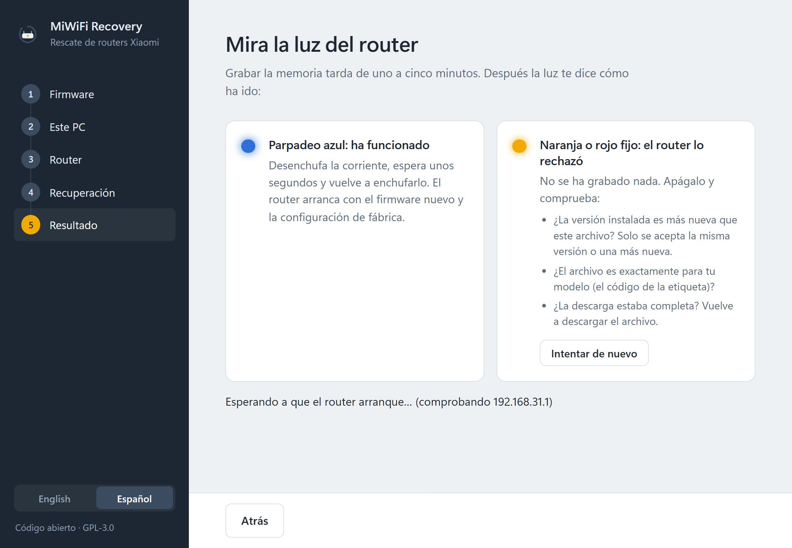
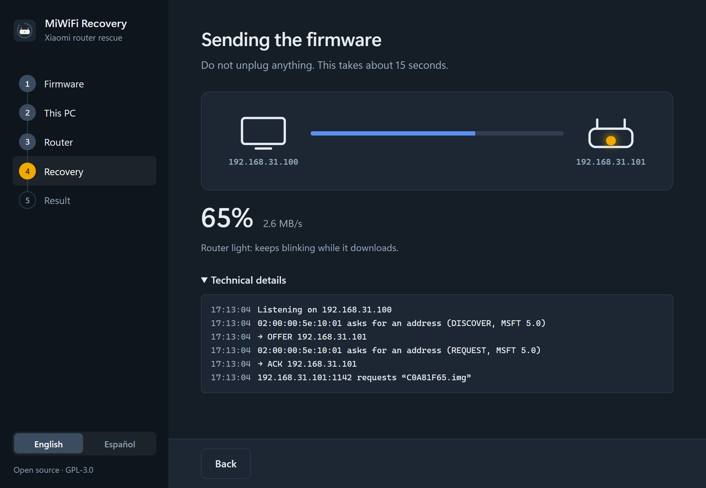

# MiWiFi Recovery (español)

[English](README.md)

Alternativa de código abierto a la "MiWiFi Repair Tool" de Xiaomi. Reinstala el firmware
oficial en un router Xiaomi que ya no arranca, usando el modo de recuperación del propio router.

- **Guiada, en español o inglés.** Antes de empezar te explica qué hacer en el PC y en el router.
- **Revisa el firmware antes de enviarlo.** Si el router lo va a rechazar, te dice por qué:
  versión anterior a la instalada (anti-rollback), modelo equivocado o descarga dañada.
- **Configura el PC por ti** (Windows, opcional). Pone en el adaptador Ethernet la dirección
  que busca el router y al final deja tu configuración como estaba. Si prefieres hacerlo a mano,
  te enseña cómo.
- **Windows y Linux.** Aplicación de escritorio para los dos y versión de línea de comandos que
  también funciona en macOS.
- **Pequeña y auditable.** Unas 3.000 líneas de Rust y HTML/CSS/JS sencillo, la mitad la interfaz bilingüe. Sin telemetría, sin
  descargas y sin instaladores dentro de instaladores.

> Úsala solo en dispositivos tuyos. La recuperación borra la configuración del router.
> Lee el [aviso legal](LEGAL.md).

## Probada

En un Xiaomi BE3600 2.5G (RD15) real, con la aplicación de Windows: configuró la dirección del
PC, reinstaló el firmware oficial 1.0.87 y rechazó la 1.0.68 antes de enviarla (anti-rollback),
igual que hace el router. Otros modelos usan el mismo modo de recuperación, pero aún no se han
probado: si lo pruebas, cuéntalo en una issue.

## Descarga

En [Releases](https://github.com/esdedev/miwifi-recovery/releases) están:
- el instalador para Windows;
- la versión portable `miwifi-recovery.exe`;
- para Linux, el paquete `.deb` (Debian, Ubuntu, Mint…) y el `.AppImage` portable;
- la versión de línea de comandos para Windows, Linux y macOS;
- `SHA256SUMS.txt`, con las sumas de control de todos los archivos.

GitHub Actions compila cada versión a partir del código etiquetado, así que cualquiera puede
comprobar cómo se hizo cada binario.

**En Linux**, DHCP y TFTP usan los puertos 67 y 69, que necesitan permiso:
- el `.deb` lo concede al instalarse;
- con el AppImage o un binario compilado por ti, ejecuta una vez
  `sudo setcap cap_net_bind_service=+ep ./miwifi-recovery` (la aplicación te avisa si falta).

En Linux la aplicación no cambia la IP por ti: te muestra el comando `ip addr`.

## Capturas

| | |
|---|---|
|  |  |
| **1. Firmware.** Modelo, versión, suma de control y comprobación anti-rollback antes de enviar nada. | **2. Este PC.** Elige el adaptador; la herramienta pone 192.168.31.100 o te explica cómo. |
|  |  |
| **3. Router.** Qué pulsar y dónde conectar el cable. | **4. Recuperación.** Transferencia en directo con registro técnico. |
|  |  |
| **5. Resultado.** Cómo leer la luz del router. | Sigue el modo oscuro del sistema. |

Las capturas usan datos de ejemplo.

## Cómo se usa

1. **Firmware.** Elige el `.bin` oficial de tu modelo. Escribe el código de modelo de la
   etiqueta del router (por ejemplo `RD15`) y, si la sabes, la versión instalada ahora.
2. **Este PC.** Conecta el cable del PC a un puerto **LAN** del router. Elige ese adaptador y
   pulsa *Configúralo por mí* (Windows pedirá permiso una vez). También puedes poner tú
   `192.168.31.100 / 255.255.255.0`.
3. **Router.** Lee los pasos: apágalo, mantén Reset pulsado, enciéndelo y suelta cuando la
   luz parpadee en naranja.
4. **Recuperación.** La herramienta espera, da una dirección al router y le envía el firmware
   (unos 15 s).
5. **Resultado.** El router comprueba la firma y graba la memoria (1–5 min):
   - **azul parpadeando**: hecho. Apágalo y enciéndelo. La herramienta te avisa cuando
     192.168.31.1 responde.
   - **naranja fijo**: rechazado. No se ha grabado nada y la pantalla te dice las causas
     habituales.

## Por qué el router rechaza un archivo

| Causa | Qué hace el router | Qué hace esta herramienta |
|---|---|---|
| Versión anterior a la instalada | `not permit upgrade!`, luz fija | Compara las versiones con la misma regla y bloquea el archivo |
| Firmware de otro modelo | `Mismatch trx model` | Compara el modelo de la imagen con tu etiqueta |
| Archivo dañado o incompleto | Error de CRC o de firma | Verifica la suma de control |
| No es una imagen de Xiaomi (OpenWrt, copia, .zip) | Error de cabecera | Detecta que falta la cabecera `HDR1` |
| No está firmado por Xiaomi | `Image verify failed!` | No se puede comprobar sin el router: decide él |

Las reglas salen del cargador de arranque del Xiaomi BE3600 2.5G (RD15). Otros modelos
funcionan de forma parecida, pero no se han verificado. La recuperación solo instala firmware
oficial de Xiaomi.

## Comparada con la herramienta oficial

La herramienta oficial es un **Tftpd32 4.61** (2019) con otra marca y la interfaz solo en
chino. Esta hace el mismo trabajo de red y además:
- revisa el firmware;
- explica los rechazos;
- guía los pasos;
- configura la IP del PC.

La oficial pide la lista de firmwares a `api.miwifi.com`, que solo devuelve tres modelos antiguos
(R4, R4Q y R4C). Además incluye DLL de depuración del runtime de Microsoft.

La comparación sale de las cadenas de texto del programa y de su propio `tftp.log`, sin
ejecutarlo. Este proyecto no afirma que la oficial tenga malware.

Más detalles en el [README en inglés](README.md) y en [docs/how-it-works.md](docs/how-it-works.md).

## Licencia

Copyright (C) 2026 Esdedev. GNU General Public License v3.0 o posterior ([LICENSE](LICENSE)).

No está afiliado a Xiaomi. "Xiaomi" y "MiWiFi" son marcas de sus propietarios y solo se usan
para indicar con qué dispositivos funciona.
